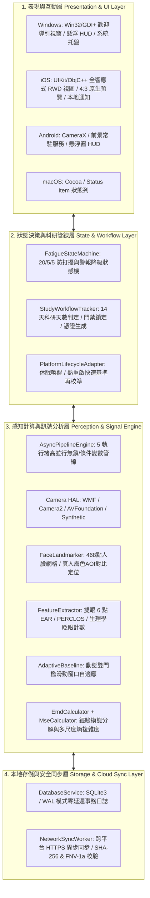
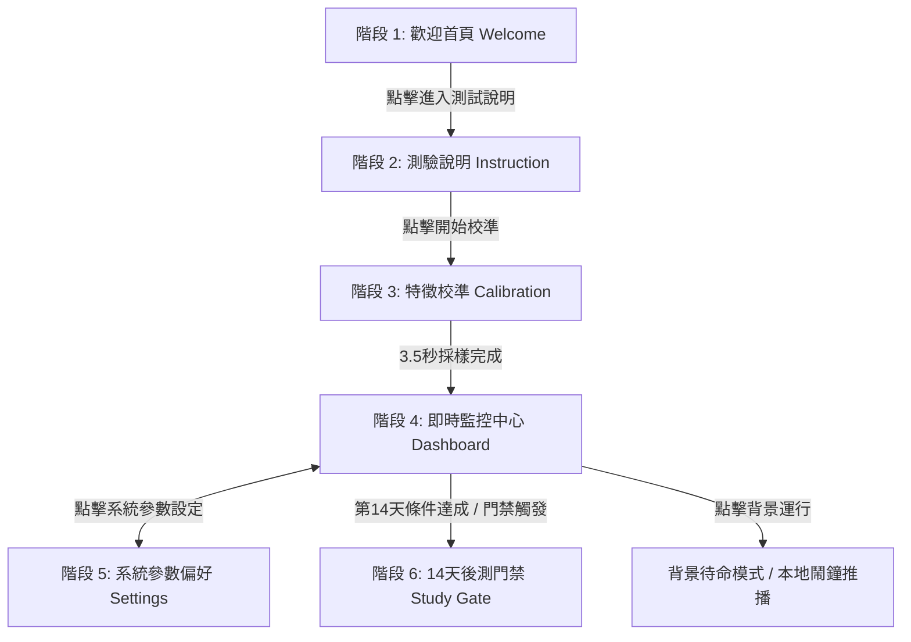
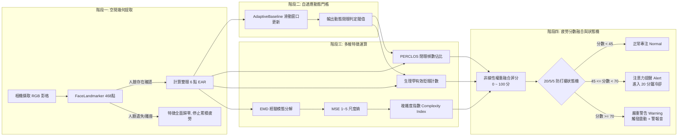
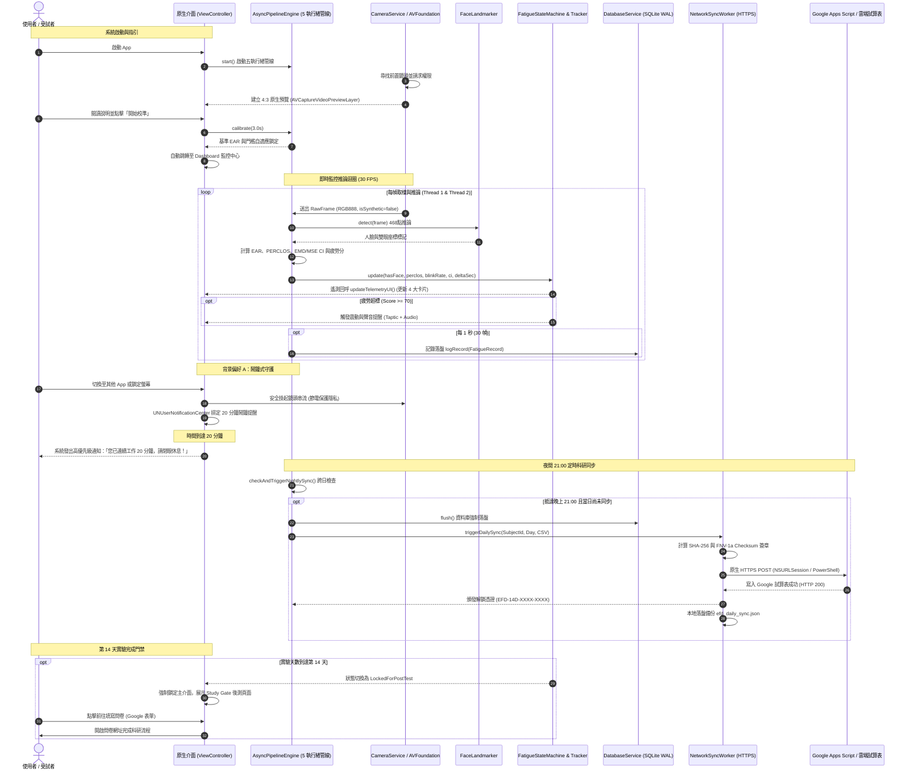

# EFD 眼睛疲勞檢測系統 (Eye Fatigue Detection Native System)

---

## 1. 系統設計目的與整體架構

### 1.1 設計目的
**EFD (Eye Fatigue Detection)** 是一套基於 **C++20** 打造的跨平台原生眼睛疲勞即時監測、分析與干預科研系統。其核心宗旨為：
1. **即時視覺健康守護**：透過前置攝影機對使用者雙眼進行毫秒級追蹤，萃取幾何眼特徵（EAR、PERCLOS、異常眨眼）與時間序列非線性複雜度（EMD 經驗模態分解、MSE 多尺度熵），精準評估疲勞程度。
2. **20/5/5 智能防打擾干預**：克服傳統檢測軟體頻繁警報導致的使用者疲乏，首創「20 分鐘絕對靜默冷卻 ➔ 5 分鐘快篩動態總評 ➔ 離座 5 分鐘清零」機制，在不干擾工作專注度的前提下提供有效干預。
3. **14 天臨床與人因工程科研追蹤**：內建完整的 14 天實驗時序排程、每日夜間 21:00 自動資料庫落盤與 Google Apps Script / 試算表雲端同步，並於第 14 天觸發問卷門禁鎖定，發放防篡改加密憑證 Token。
4. **極致隱私保護與邊緣運算**：所有影像特徵分析與特徵點定位完全在終端裝置本地端（Edge Computing）即時運算，影像絕不上傳或留存，兼顧效能、低耗能與受試者隱私。

### 1.2 系統設計架構
系統採用高內聚、低耦合的分層架構（Layered Architecture），由四大核心階層協同運作：



---

## 2. 系統主要功能

| 功能模組 | 技術實現 | 功能說明 |
| :--- | :--- | :--- |
| **五執行緒異步管線** | `AsyncPipelineEngine` | 包含相機採集線程、視覺特徵推論線程、訊號與狀態分析線程、本地資料庫落盤線程與雲端同步線程，保證 UI 永遠維持 60 FPS 流暢無卡頓。 |
| **多硬體相機抽象層 (HAL)** | `CameraService` | 統一封裝 Windows Media Foundation、Android Camera2/CameraX、Apple AVFoundation 與 Synthetic 虛擬測試相機，支援實體鏡頭斷線無縫自動熱回退。 |
| **動態基線自我校準** | `AdaptiveBaseline` | 具備「抗微睡眠污染」機制，僅採集清醒睜眼區間；裝置喚醒時啟動 1 秒「熱重啟快速再校準」，消除坐姿與環境光照漂移。 |
| **非線性動態複雜度分析** | `EmdCalculator` + `MseCalculator` | 對 EAR 時序訊號進行經驗模態分解（EMD）過濾高頻眼顫雜訊，再透過多尺度熵（MSE, 尺度 1~5）計算複雜度指數（CI），辨識大腦中樞神經調節疲勞度。 |
| **20/5/5 智能防打擾干預** | `FatigueStateMachine` | 符合人因工程學：初次提醒後鎖死 20 分鐘；第 20~25 分鐘執行輕量快篩；若持續惡化則升級嚴重警告；離座滿 5 分鐘自動重置。 |
| **14 天科研週期管理** | `StudyWorkflowTracker` | 自動累計受試天數；每晚 21:00 定時觸發完整性簽章上傳；第 14 天強制跳轉後測問卷（Google 表單），並回傳防偽解鎖憑證（`EFD-14D-XXXX-XXXX`）。 |
| **跨平台原生資料同步** | `NetworkSyncWorker` | Windows 端採用 PowerShell，Apple 端（iOS/macOS）採用原生 `NSURLSession` HTTPS，自動封裝時序資料並寫入 Google 試算表。 |

---

## 3. 系統介面功能與設計目的

本系統遵循嚴格的色彩與人因工程視覺規範，全介面採用 5 大核心識別配色：
* **薄荷綠（Primary Mint, `#1EB18A`）**：主介面基底，象徵護眼、放鬆與科技感。
* **晴空藍（Accent Blue, `#96C5F7`）**：圖示裝飾與數值輔助強調色。
* **純白（Card White, `#FFFFFF`）**：指標卡片與重要操作按鈕背景，提供高對比清晰度。
* **暖琥珀黃（Warm Amber, `#F7E3AF`）**：副標題、凝視標記與警示提示色。
* **深墨黑（Text Dark, `#25291C`）**：卡片文字與數據數值專用色，防強烈刺眼。
* **警戒珊瑚紅（Alert Coral, `#EB5757`）**：背景運行與緊急疲勞告警專用色。

系統在各平台（Windows / iOS / Android）上具備對應的原生導引流程，包含 6 大標準介面：



### 3.1 階段 1：歡迎首頁 (Welcome Screen)
* **設計目的**：建立受試者品牌信任感，清楚傳達研究系統的主旨與隱私邊界，引導使用者進入合規測試流程。
* **功能清單**：
  * **官方徽章標誌**：頂部圓形徽章內嵌官方「資產 10」高解析度 Logo，具備琥珀金外框。
  * **主標題與副標題**：「感謝協助測試 EFD」結合「AI 驅動眼睛特徵提取與即時疲勞監控研究系統」。
  * **全螢幕 RWD 與安全區域（Safe Area）防護**：完美適配 iPhone 13 瀏海/動態島與 Home 橫條，消除上下黑邊。
  * **進入測試說明按鈕**：大型白底圓角按鈕（22pt 圓角），引導受試者進入下一階段。

### 3.2 階段 2：測驗指引說明介面 (Instruction Screen)
* **設計目的**：向受試者傳達端正坐姿、相機視角與眨眼規範，降低人為採樣誤差，提升後續特徵運算之信度與效度。
* **功能清單**：
  * **三大指引卡片**：
    1. *臉部正面對齊鏡頭*：保持端正坐姿，確保前置鏡頭清晰捕捉雙眼面部特徵。
    2. *視線專注平視螢幕*：校準開始後專注凝視螢幕中央指示標記，避免晃動。
    3. *保持自然眨眼狀態*：3.5 秒動態採樣，系統將自適應計算個人化基準 EAR。
  * **彈性滾動容器（`UIScrollView`）**：文字卡片具備獨立滾動容器，在任何尺寸螢幕下**絕不與底部操作按鈕重疊**。
  * **雙層導引按鈕**：「我準備好了，開始校準」主操作按鈕與「返回歡迎介面」輔助按鈕。

### 3.3 階段 3：眼動特徵基準校準介面 (Calibration Screen)
* **設計目的**：在受試者放鬆睜眼狀態下，於 3.5 秒內連續取樣 100+ 幀雙眼特徵，計算個人專屬的基礎 EAR 均值與閉眼判定動態門檻。
* **功能清單**：
  * **視覺凝視黃點**：螢幕中央配置直徑 60pt 之暖琥珀色動態圓點，具備晴空藍外暈光環，吸引使用者平視鎖定。
  * **高對比金色進度條**：以 0.05 秒為週期即時更新 3.5 秒進度條，給予受試者精確的時間進度預期。
  * **自動切換機制**：進度達到 100% 時，自動觸發 `AsyncPipelineEngine::calibrate(3.0f)` 寫入個人化基準，無縫切換至即時監控中心。

### 3.4 階段 4：即時眼睛疲勞監控中心 (Dashboard Screen)
* **設計目的**：本系統核心操作儀表板。提供前置鏡頭影像驗證、核心生理特徵數據展示，並支援多種運行模式切換。
* **功能清單**：
  * **4:3 實體相機即時串流視窗**：
    * 嚴格鎖定 4:3 比例，嵌入原生相機串流圖層（Apple AVFoundation `AVCaptureVideoPreviewLayer`）。
    * 當鏡頭成功捕捉時，即時回顯真人影像；當使用者離席時，狀態即時提示「無人臉離座」，數據自動歸零保護。
  * **4 大核心監控指標卡片（2x2 響應式佈局）**：
    1. *雙眼 EAR*：即時眼寬高比（精確至小數點後三位，常態約 0.280 ~ 0.350）。
    2. *閉眼比 (PERCLOS)*：60 秒滑動窗口內眼睛完全閉合之幀數佔比（常態 < 15%）。
    3. *複雜度 (MSE / CI)*：多尺度熵複雜度指數，反映自律神經與睫狀肌調節活力（常態 > 2.0）。
    4. *綜合疲勞分數*：0 ~ 100 分之綜合非線性疲勞指數。
  * **控制按鈕群**：
    * 「重新偵測疲勞數據」：一鍵返回說明介面重新採樣基準。
    * 「系統參數設定」：進入參數調整視窗。
    * 「背景運行模式」：以醒目珊瑚紅按鈕提示切換至省電背景待命。

### 3.5 階段 5：系統參數與偏好設定 (Settings Screen)
* **設計目的**：提供受試者根據自身用眼習慣自訂警報靈敏度、提示聲響與背景守護行為。
* **功能清單**：
  * **高靈敏度疲勞偵測開關**：切換判定窗口頻率（由 5 分鐘快篩提升至 3 分鐘快篩）。
  * **疲勞警報提示音開關**：控制疲勞超標時是否觸發音效與震動（Taptic Engine 觸覺回饋）。
  * **開機自動背景啟動開關**：管理開機自動待命狀態。
  * **自動科研同步開關**：受試者防呆設計，系統預設恆定開啟（每晚 21:00 自動落盤同步）並強制鎖定，確保實驗數據完整。
  * **獨立底部返回按鈕**：「返回監控中心」白底綠字按鈕，貼齊底部安全區域。

### 3.6 階段 6：第 14 天後測門禁解鎖介面 (Study Gate Screen)
* **設計目的**：科研倫理與資料回收管制關鍵閘門。於受試者達到第 14 天時自動鎖定主功能，強制填寫 Google 後測問卷，達成雙向資料閉環。
* **功能清單**：
  * **實驗封存提示卡**：展示受試者 14 天實驗完成狀態，提示資料庫簽章校驗成功。
  * **外部跳轉與自動核銷**：點擊「前往填寫後測問卷 (Google 表單)」自動開啟 Safari / 瀏覽器；填寫後系統自動發放後測核銷 Token。

---

## 4. 眼睛疲勞數據判定邏輯與運作架構

系統評估疲勞的運作流程結合了「空間幾何解算」、「時間序列統計」、「非線性物理動力學」與「有限狀態機」四重模型：



### 4.1 雙眼幾何特徵 (EAR Formula)
採用標準 MediaPipe 6 點眼部拓撲標記（左眼 33, 160, 158, 133, 153, 144；右眼 362, 385, 387, 263, 373, 380）：
$$\text{EAR} = \frac{\|p_2 - p_6\| + \|p_3 - p_5\|}{2 \cdot \|p_1 - p_4\|}$$
* 計算左眼 $\text{EAR}_L$ 與右眼 $\text{EAR}_R$ 之平均值：$\text{EAR}_{\text{avg}} = \frac{\text{EAR}_L + \text{EAR}_R}{2}$。
* **離座保護機制**：若畫面中未偵測到正面人臉（`hasFace == false`），系統強制將 $\text{EAR}_{\text{avg}}$ 與相關統計重置為 0，嚴禁假數據污染。

### 4.2 動態自適應雙門檻 (Adaptive Baseline)
不同使用者的眼睛生理構造（單/雙眼皮、大小眼）以及不同距離與光線差異極大。系統拒絕使用固定閾值，採用雙向滑動窗口自適應：
1. **抗微睡眠污染（Selective Inclusion）**：
   僅當 $\text{EAR} > \text{Threshold}_{\text{open}}$ 且連續維持清醒時，才將數據納入滑動平均統計，防止受試者打瞌睡時動態門檻被「往下拖拽」導致永遠判定為未閉眼。
2. **熱重啟快篩（Fast Recalibration）**：
   當 App 自休眠或背景喚醒時，利用前 30 幀快速重新對齊基準，1 秒內適應環境光線變更。

### 4.3 閉眼比例 (PERCLOS) 與生理學眨眼率 (Blink Rate)
* **PERCLOS**：計算過去滑動窗口（例如 60 秒 / 1800 幀）內，$\text{EAR} < \text{Threshold}_{\text{closed}}$ 的閉眼幀數佔總有效幀數之百分比。
* **生理學眨眼過濾**：
  * 人體正常有效眨眼時長介於 **67 毫秒 至 800 毫秒**（約 2 ~ 25 幀）。
  * 系統自動過濾 $< 2$ 幀的影像雜訊，並排除 $> 25$ 幀的蓄意瞇眼或打瞌睡（歸類為 Prolonged Eye Closure），計算純淨的每分鐘眨眼率。

### 4.4 經驗模態分解 (EMD) 與多尺度熵 (MSE) 複雜度
眼動時序中夾雜著眼球微顫與高頻抖動。傳統方法容易將抖動誤判為清醒眼動。
1. **EMD 篩選過程**：
   透過三次樣條內插尋找時序訊號之局部極大值與極小值包絡線，分解出固有模態函數（Intrinsic Mode Functions, IMF）。取前兩階主要 IMF 反映真實眼瞼肌電調控。
2. **MSE 多尺度粗粒化（Coarse-Graining）與樣本熵（Sample Entropy）**：
   將訊號在時間尺度 $\tau \in [1, 5]$ 上進行粗粒化平均，計算各尺度之條件概率樣本熵 $S_E(\tau)$：
   $$\text{CI (Complexity Index)} = \sum_{\tau=1}^{5} S_E(\tau)$$
   * **生理學意義**：大腦處於高度專注與清醒時，神經調控具備高度非線性動力學豐富度（$\text{CI} \ge 2.5$）；當進入疲勞或睏倦時，調控機制鈍化，時序趨於規律單調，$\text{CI}$ 顯著驟降至 $1.0$ 以下。

### 4.5 疲勞綜合評分與 20/5/5 狀態機決策
* **多維特徵融合**：
  $$\text{Score} = w_1 \cdot f(\text{PERCLOS}) + w_2 \cdot g(\text{BlinkRate}) + w_3 \cdot h(\text{Complexity})$$
  其中權重分佈：PERCLOS 佔 55%，眨眼異常度佔 25%，複雜度鈍化佔 20%。
* **20/5/5 防打擾推進邏輯**：
  1. **冷卻期（Cooldown, 20 分鐘）**：發出提醒後強制進入 20 分鐘靜默期，避免持續彈窗造成干擾。
  2. **快篩評估期（Screening, 5 分鐘）**：第 20 至 25 分鐘間啟動動態快篩。若疲勞指數已顯著恢復（$\text{Score} < 45$），狀態機降級平復為 Normal；若持續超標（$\text{Score} \ge 70$），立即升級觸發警告。
  3. **離座重置（Absence Reset）**：若連續 5 分鐘未偵測到人臉，自動判定使用者已離席休息，重新計時冷卻週期。

---

## 5. 系統端到端完整流程架構

系統各模組從程式啟動、相機取幀、即時運算到每日 21:00 定時科研同步的詳細流程如下：



---

## 6. 目錄結構與關鍵原始碼指南

```text
EFD/
├── CMakeLists.txt                # 跨平台 CMake 構建檔 (Windows / iOS / macOS 統一編譯)
├── README.md                     # 系統核心架構、介面功能與演算法設計白皮書
├── .github/workflows/
│   └── build_ios.yml             # GitHub Actions 自動化 CI/CD 打包產出 EFD_iOS.ipa
├── include/efd/
│   ├── types.hpp                 # 全域結構體定義 (Point3D, EyeMetrics, FatigueRecord)
│   └── version.hpp               # 版本資訊 (v2.0.0)
├── src/
│   ├── analysis/                 # 生理特徵與非線性訊號分析
│   │   ├── FeatureExtractor.cpp  # 雙眼 EAR、PERCLOS、生理學眨眼率計算
│   │   ├── AdaptiveBaseline.cpp  # 抗微睡眠污染之動態滑動窗口自適應門檻
│   │   ├── EmdCalculator.cpp     # 經驗模態分解 (EMD) 與三次樣條包絡線
│   │   └── MseCalculator.cpp     # 多尺度熵 (MSE) 與複雜度指數 (CI)
│   ├── engine/
│   │   └── AsyncPipelineEngine.cpp # 五執行緒非同步管線排程與跨模組協調中心
│   ├── network/                  # 雲端同步與數據安全通訊
│   │   ├── NetworkSyncWorker.cpp # 異步工作佇列、SHA-256 完整性校驗與憑證生成
│   │   ├── NetworkSyncWorkerApple.h
│   │   └── NetworkSyncWorkerApple.mm # iOS / macOS 原生 NSURLSession HTTPS POST 實作
│   ├── state/
│   │   └── FatigueStateMachine.cpp  # 20/5/5 防打擾、快篩與升級有限狀態機
│   ├── storage/
│   │   └── DatabaseService.cpp   # SQLite3 / WAL 高併發交易日誌落盤
│   ├── study/
│   │   └── StudyWorkflowTracker.cpp # 14 天實驗天數計算、夜間排程與門禁事務鎖
│   ├── vision/                   # 視覺感知與相機硬體抽象層
│   │   ├── CameraService.cpp     # 相機服務中心、看門狗監控與驅動切換
│   │   ├── FaceLandmarker.cpp    # 468 點特徵定位與真人膚色 AOI 對比追蹤
│   │   └── drivers/              # 各平台原生相機驅動
│   │       ├── AppleAvFoundationCameraDriver.mm # iOS 前置相機即時串流驅動
│   │       ├── WindowsMfCameraDriver.cpp        # Windows Media Foundation 驅動
│   │       └── SyntheticCameraDriver.cpp        # 離線虛擬測試相機驅動
│   └── ui/                       # 使用者介面層
│       ├── NativeWelcomeWindow.cpp # Windows 原生 GDI+ 歡迎與監控視窗
│       └── FatigueFloatingIndicator.cpp # Windows 桌面置頂透明 HUD 懸浮球
└── ios/                          # iOS 原生應用程式封裝
    ├── Info.plist                # iOS 權限、全螢幕原生 UILaunchScreen 與背景模式
    ├── AppDelegate.mm            # iOS 生命週期調度
    ├── ViewController.mm         # iOS 全 RWD 響應式介面 (6 大分頁、AVFoundation 預覽、本地通知)
    ├── logo.png                  # EFD 官方資產 10 Logo
    └── 資產 10.png               # EFD 官方資產 10 原始圖檔
```

---

## 7. 構建與部署指南

### 7.1 Windows 環境 (Visual Studio 2022)
```powershell
# 1. 產生 Visual Studio 專案
cmake -B build/vs-x64 -G "Visual Studio 17 2022" -A x64

# 2. 編譯測試與主程式
cmake --build build/vs-x64 --config Release

# 3. 執行單元整合測試 (12/12 PASS)
.\build\vs-x64\tests\Release\efd_tests.exe
```

### 7.2 iOS 環境 (.ipa 封裝與側載)
透過 GitHub Actions 雲端自動化或 macOS 本地建置：
```bash
# 1. 產生 Xcode iOS 專案
cmake -B build/ios -G Xcode -DCMAKE_SYSTEM_NAME=iOS -DCMAKE_OSX_DEPLOYMENT_TARGET=15.0

# 2. 封裝 App Archive
xcodebuild archive -project build/ios/EFD.xcodeproj -scheme EFD_iOS -configuration Release -destination "generic/platform=iOS" -archivePath build/EFD_iOS.xcarchive CODE_SIGN_IDENTITY="" CODE_SIGNING_REQUIRED=NO

# 3. 打包成 EFD_iOS.ipa 即可透過 Sideloadly 側載至 iPhone 13
```
