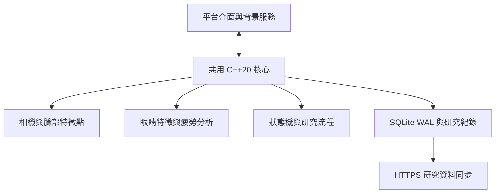

# EFD 眼睛疲勞檢測系統

EFD（Eye Fatigue Detection）是一套以 C++20 建置的跨平台眼睛疲勞即時監測與研究資料收集系統，支援 Windows 桌面電腦與 Android 行動裝置。兩種平台共用同一套疲勞分析、狀態決策、資料儲存與研究流程；差異只在相機、使用者介面與背景執行方式。

> 本文件是 Windows 與 Android 的統一系統介紹。平台專用的操作細節請參考 [`docs/`](docs/) 內的既有說明書；該目錄文件與本次整理無關，未予修改。

## 1. 系統目的

- 以裝置端攝影機即時擷取臉部與眼睛特徵，評估長時間用眼造成的疲勞趨勢。
- 以 EAR、PERCLOS、眨眼資訊、EMD 與 MSE 等指標形成綜合疲勞分數。
- 透過 20/5/5 防打擾機制，在降低通知干擾的同時提供必要提醒。
- 支援 14 天研究週期、A/B 交叉分組、每日摘要與研究資料同步。
- 影像只在本機記憶體中處理；儲存與同步的內容是數值特徵和研究紀錄，不是影像。

## 2. 系統整體架構



### 2.1 共用核心

| 模組 | 職責 |
|---|---|
| `CameraService` / `VisionPipeline` | 封裝相機取像、格式轉換、臉部特徵點輸入與相機故障回退。 |
| `FeatureExtractor` | 計算雙眼 EAR、PERCLOS、眨眼率、眨眼時長與長閉眼事件。 |
| `RollingOpenBaseline` / `AdaptiveBaseline` | 依個人睜眼狀態建立動態基準，降低坐姿與光線變化造成的誤判。 |
| `EmdCalculator` / `MseCalculator` | 從 EAR 時序訊號計算 EMD 與多尺度熵複雜度指數。 |
| `FatigueStateMachine` | 執行疲勞分數平滑、提醒門檻、冷卻、快篩與離座重置。 |
| `AsyncPipelineEngine` | 協調相機、推論、分析、資料庫與同步工作，避免阻塞使用者介面。 |
| `DatabaseService` / `StudyDataLog` | 以 SQLite WAL 儲存原始摘要、每分鐘統計、提醒與自評資料。 |
| `StudyWorkflowTracker` | 管理 14 天研究日、A/B 組提醒週期、夜間同步與第 14 天後測門禁。 |
| `NetworkSyncWorker` | 建立同步資料、計算完整性校驗值，並交由平台網路層上傳。 |

### 2.2 Windows 與 Android 的共同口徑

兩個平台都使用 478 點臉部特徵點與相同的疲勞分析邏輯。Windows 以 ONNX Runtime 執行模型，Android 以 MediaPipe Tasks 執行模型，再將結果轉換為共用核心格式，因此 EAR、PERCLOS、疲勞分數與提醒規則維持一致。

| 項目 | Windows | Android |
|---|---|---|
| 使用情境 | Windows 10/11 x64 桌面或筆記型電腦 | Android 7.0（API 24）以上 |
| 相機層 | Windows Media Foundation | CameraX |
| 臉部模型執行 | ONNX Runtime；模型缺少時可用啟發式備援 | MediaPipe Face Landmarker |
| 介面 | 原生視窗、監控中心、系統托盤與桌面 HUD | 原生 App、前景服務與系統通知 |
| 背景監控 | 隱藏主視窗後由系統托盤常駐 | 前景服務維持監控；看門狗偵測服務是否被系統停止 |
| 網路同步 | Windows 網路層／PowerShell | Java `HttpURLConnection` 橋接 |
| 測試相機 | 支援 Synthetic 虛擬相機 | 核心仍支援 Synthetic，實機使用前置鏡頭 |

## 3. 使用流程

兩種平台的操作流程一致，介面呈現方式依平台調整：

1. **歡迎與研究分組**：首次使用由研究人員選擇 A 組或 B 組，選定後鎖定。
2. **測驗說明與權限確認**：說明特徵分析與隱私範圍，確認相機及必要通知權限。
3. **個人基準校準**：依畫面提示保持臉部與眼睛可見，完成約 3.5 秒的基準採樣。
4. **即時監控中心**：顯示雙眼 EAR、PERCLOS、MSE 複雜度、疲勞分數與目前狀態。
5. **背景監控**：使用者可離開主畫面，系統持續執行並在需要時提醒。
6. **疲勞提醒與自評**：提醒時提供 0～10 的眼睛疲勞自評，可略過。
7. **14 天後測**：研究天數完成後鎖定監控入口，導向後測問卷與研究完成流程。

## 4. 疲勞判定與提醒策略

### 4.1 分析指標

- **EAR（Eye Aspect Ratio）**：由眼睛特徵點計算睜眼程度，並以個人校準基準判斷閉眼。
- **PERCLOS**：統計時間窗內的閉眼比例，用於反映持續性疲勞。
- **眨眼事件**：記錄眨眼率、眨眼時長與異常長閉眼。
- **EMD/MSE**：分析 EAR 時序的非線性與複雜度，補足單一幾何指標的限制。
- **綜合疲勞分數**：將上述訊號平滑後形成 0～100 的狀態判定依據。

### 4.2 20/5/5 防打擾機制

1. 平滑疲勞分數達 **65** 且持續約 **5 秒**，才觸發提醒條件。
2. 提醒後進入 **20 分鐘冷卻**，期間不重複打擾，但仍持續記錄資料。
3. 冷卻結束後，以約 **5 分鐘** 的快篩週期重新評估是否需要提醒。
4. 偵測到使用者離座滿 **5 分鐘**，視為完成休息並清除冷卻狀態。
5. 研究組別處於「只記錄」週期時，仍會分析與保存資料，但不顯示提醒。

## 5. 研究資料流程

- 以 SQLite WAL 儲存本機資料，包含逐筆分析結果、每分鐘摘要、提醒事件與自評。
- 每日晚間約 21:00 觸發當日同步；同步資料包含研究所需的數值摘要，不包含相機影像。
- 同步流程使用 SHA-256 與 FNV-1a 等校驗資訊確認資料完整性，並保留本機備份。
- 第 14 天完成後進入 `Study Gate`，產生研究完成憑證並引導填寫後測問卷。

## 6. 專案結構

```text
EFD/
├── include/efd/                 # 共用型別與版本資訊
├── src/
│   ├── analysis/                 # EAR、PERCLOS、EMD、MSE 與基準
│   ├── engine/                  # 非同步分析管線
│   ├── network/                 # 同步資料與完整性校驗
│   ├── state/                   # 疲勞狀態機
│   ├── storage/                 # SQLite 與研究紀錄
│   ├── study/                   # 14 天研究流程
│   ├── vision/                  # 相機、特徵點與平台驅動
│   └── ui/                      # Windows 原生 UI 與 HUD
├── android/
│   └── app/src/main/            # Android Activity、CameraX、前景服務與 JNI
├── models/                      # Android task 與 Windows ONNX 模型
├── tests/                       # 單元、整合與診斷重播測試
├── CMakeLists.txt               # Windows 與共用核心建置
└── package_windows.ps1          # Windows 可攜版打包
```

## 7. 建置與啟動

### 7.1 Windows

需求：Visual Studio 2022（含 C++ 桌面開發）、CMake 3.20 以上。若要使用模型推論，請將 ONNX Runtime 1.31.0 解壓至 `third_party/onnxruntime/`；缺少時會退回啟發式偵測。

```powershell
cmake -B build\vs-x64 -A x64
cmake --build build\vs-x64 --config Release
.\build\vs-x64\tests\Release\efd_tests.exe
.\package_windows.ps1
```

執行已打包版本時，請保留 `EFD.exe`、`onnxruntime.dll`、`models\` 與授權文件的相對位置。Windows 版是免安裝可攜式程式，可由 `EFD.exe` 或啟動批次檔開啟。

### 7.2 Android

需求：Android Studio、JDK 17、Android SDK、NDK 28.2.13676358。正式簽章設定放在 `android/keystore.properties`，不要加入版本庫。

```powershell
Set-Location android
.\gradlew.bat assembleDebug
.\gradlew.bat assembleRelease
```

建置會依 CPU 產出 `arm64-v8a`、`armeabi-v7a` 與 `x86_64` APK。首次開啟需允許相機與通知權限；若要在 App 被劃掉後持續監控，還需依裝置品牌完成電池最佳化與背景執行設定。

## 8. 隱私、權限與授權

- 影像只在裝置記憶體中分析，不儲存、不上傳，也沒有影像匯出功能。
- 網路同步只傳送疲勞數值、時間摘要、研究狀態與自評資料。
- Windows 需要相機存取權；Android 另外需要相機、通知、前景服務與網路等權限。
- Android 的 MediaPipe 統計回傳後端已在 Manifest 中移除；MediaPipe 本身仍保留必要執行依賴。
- 第三方元件與模型授權請參閱 [`THIRD_PARTY_NOTICES.md`](THIRD_PARTY_NOTICES.md)。

## 9. 相關文件

- [`docs/`](docs/)：平台操作說明與研究文件（既有文件未由本次變更修改）。
- [`System design.md`](System%20design.md)：詳細設計、狀態機與資料流程。
- [`models/README.md`](models/README.md)：臉部模型來源、格式與 ONNX 轉換方式。
- [`THIRD_PARTY_NOTICES.md`](THIRD_PARTY_NOTICES.md)：第三方元件與授權清單。
