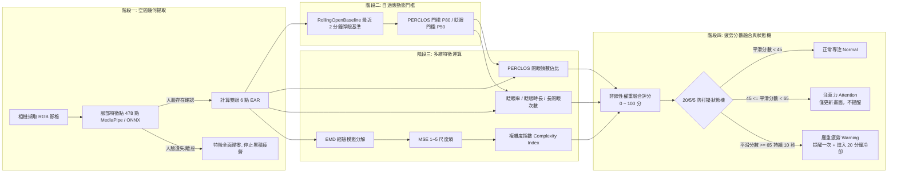
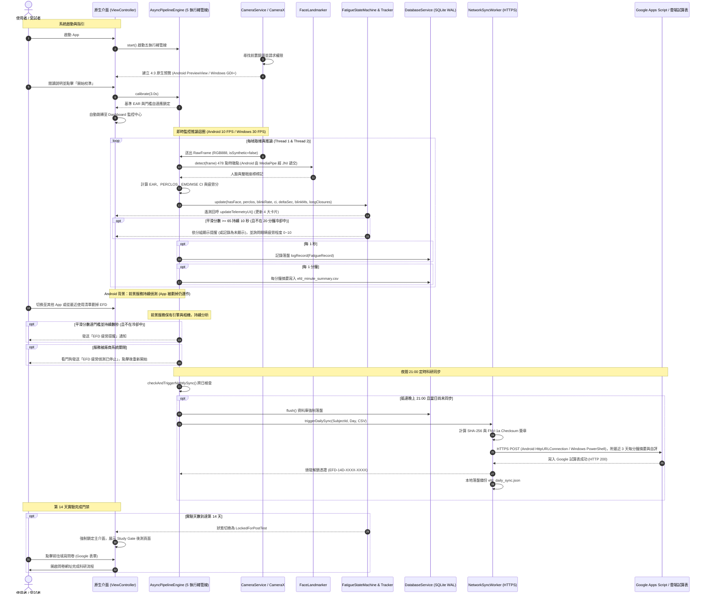

# EFD 眼睛疲勞檢測系統 (Eye Fatigue Detection Native System)

---

## 1. 系統設計目的與整體架構

### 1.1 設計目的
**EFD (Eye Fatigue Detection)** 是一套基於 **C++20** 打造的跨平台原生眼睛疲勞即時監測、分析與干預科研系統。其核心宗旨為：
1. **即時視覺健康守護**：透過前置攝影機對使用者雙眼進行毫秒級追蹤，萃取幾何眼特徵（EAR、PERCLOS、異常眨眼）與時間序列非線性複雜度（EMD 經驗模態分解、MSE 多尺度熵），精準評估疲勞程度。
2. **20/5/5 智能防打擾干預**：克服傳統檢測軟體頻繁警報導致的使用者疲乏，首創「20 分鐘絕對靜默冷卻 ➔ 5 分鐘快篩動態總評 ➔ 離座 5 分鐘清零」機制，在不干擾工作專注度的前提下提供有效干預。
3. **14 天臨床與人因工程科研追蹤**：內建完整的 14 天實驗時序排程、每日夜間 21:00 自動資料庫落盤與 Google Apps Script / 試算表雲端同步，並於第 14 天觸發問卷門禁鎖定，發放防篡改加密憑證 Token。
4. **極致隱私保護與邊緣運算**：所有影像特徵分析與特徵點定位完全在終端裝置本地端（Edge Computing）即時運算，影像絕不上傳或留存，兼顧效能、低耗能與受試者隱私。

### 1.2 系統設計架構
系統採用高內聚、低耦合的分層架構（Layered Architecture），由四大核心階層協同運作：

```mermaid
graph TD
    subgraph Layer1 [1. 表現與互動層 Presentation & UI Layer]
        WIN_UI[Windows: Win32/GDI+ 歡迎導引視窗 / 懸浮 HUD / 系統托盤]
        AND_UI[Android: CameraX / 前景常駐服務 / 懸浮窗 HUD]
    end

    subgraph Layer2 [2. 狀態決策與科研管線層 State & Workflow Layer]
        SM[FatigueStateMachine: 20/5/5 防打擾與警報降級狀態機]
        SWT[StudyWorkflowTracker: 14天科研天數判定 / 門禁鎖定 / 憑證生成]
        PLA[PlatformLifecycleAdapter: 休眠喚醒 / 熱重啟快速基準再校準]
    end

    subgraph Layer3 [3. 感知計算與訊號分析層 Perception & Signal Engine]
        APE[AsyncPipelineEngine: 5 執行緒高並行無鎖/條件變數管線]
        CHAL[Camera HAL: WMF / CameraX (JNI) / Synthetic]
        FL[臉部特徵點: Android MediaPipe / Windows ONNX Runtime 478 點 (啟發式備援)]
        FE[FeatureExtractor: 雙眼 6 點 EAR / PERCLOS / 眨眼與長閉眼]
        AB[RollingOpenBaseline: 最近 2 分鐘睜眼基準 P80 / P50 門檻]
        EMD_MSE[EmdCalculator + MseCalculator: 經驗模態分解與多尺度熵複雜度]
    end

    subgraph Layer4 [4. 本地存儲與安全同步層 Storage & Cloud Sync Layer]
        DB[DatabaseService: SQLite3 / WAL 模式零延遲事務日誌]
        NSW[NetworkSyncWorker: 跨平台 HTTPS 異步同步 / SHA-256 & FNV-1a 校驗]
        SDL[StudyDataLog: 每分鐘摘要 / 提醒時的眼睛疲勞自評]
    end

    Layer1 <--> Layer2
    Layer2 <--> Layer3
    Layer3 <--> Layer4
```

---

## 2. 系統主要功能

| 功能模組 | 技術實現 | 功能說明 |
| :--- | :--- | :--- |
| **五執行緒異步管線** | `AsyncPipelineEngine` | 包含相機採集線程、視覺特徵推論線程、訊號與狀態分析線程、本地資料庫落盤線程與雲端同步線程，保證 UI 永遠維持 60 FPS 流暢無卡頓。 |
| **臉部特徵點偵測** | `ILandmarkDetector` | Android 以 **MediaPipe Face Landmarker** (Tasks Vision 0.10.35)、Windows 以 **ONNX Runtime 1.31.0** 執行同一份模型，量測 478 點特徵點；只有數值進入 C++ 核心，影像不儲存也不上傳。模型無法載入時退回啟發式偵測。 |
| **相機省電** | `AsyncPipelineEngine` + CameraX | 20 分鐘冷卻期間關閉相機，快篩只在最後 1 分鐘取樣；螢幕關閉時暫停；連續 10 秒沒有臉時降為每 0.5 秒偵測一次。 |
| **交叉設計與資料收集** | `StudyWorkflowTracker` + `StudyDataLog` | 研究人員為受試者選 A/B 組 (A 組第 8~14 天提醒、B 組第 1~7 天提醒)；每分鐘一筆數值摘要，每次提醒詢問一題眼睛疲勞程度 (0~10)。 |
| **多硬體相機抽象層 (HAL)** | `CameraService` | 統一封裝 Windows Media Foundation、Android CameraX 與 Synthetic 虛擬測試相機，支援實體鏡頭斷線無縫自動熱回退。 |
| **動態基線自我校準** | `AdaptiveBaseline` | 具備「抗微睡眠污染」機制，僅採集清醒睜眼區間；裝置喚醒時啟動 1 秒「熱重啟快速再校準」，消除坐姿與環境光照漂移。 |
| **非線性動態複雜度分析** | `EmdCalculator` + `MseCalculator` | 對 EAR 時序訊號進行經驗模態分解（EMD）過濾高頻眼顫雜訊，再透過多尺度熵（MSE, 尺度 1~5）計算複雜度指數（CI），辨識大腦中樞神經調節疲勞度。 |
| **20/5/5 智能防打擾干預** | `FatigueStateMachine` | 60 秒平滑分數 ≥ 65 持續 10 秒才提醒，之後 20 分鐘不再提醒；冷卻期滿每 5 分鐘以平均分數快篩一次；離座滿 5 分鐘視為已休息並清除冷卻。完整規格見 `System design.md` 第 5.2 節。 |
| **14 天科研週期管理** | `StudyWorkflowTracker` | 自動累計受試天數；每晚 21:00 定時觸發完整性簽章上傳；第 14 天強制跳轉後測問卷（Google 表單），並回傳防偽解鎖憑證（`EFD-14D-XXXX-XXXX`）。 |
| **跨平台原生資料同步** | `NetworkSyncWorker` | Windows 端採用 PowerShell，Android 端由 Java 層 HTTPS 上傳，自動封裝時序資料並寫入 Google 試算表。 |

---

## 3. 系統介面功能與設計目的

本系統遵循嚴格的色彩與人因工程視覺規範，全介面採用 5 大核心識別配色：
* **薄荷綠（Primary Mint, `#1EB18A`）**：主介面基底，象徵護眼、放鬆與科技感。
* **晴空藍（Accent Blue, `#96C5F7`）**：圖示裝飾與數值輔助強調色。
* **純白（Card White, `#FFFFFF`）**：指標卡片與重要操作按鈕背景，提供高對比清晰度。
* **暖琥珀黃（Warm Amber, `#F7E3AF`）**：副標題、凝視標記與警示提示色。
* **深墨黑（Text Dark, `#25291C`）**：卡片文字與數據數值專用色，防強烈刺眼。
* **警戒珊瑚紅（Alert Coral, `#EB5757`）**：背景運行與緊急疲勞告警專用色。

系統在各平台（Windows / Android）上具備對應的原生導引流程，包含 6 大標準介面：

```mermaid
flowchart TD
    S1[階段 1: 歡迎首頁 Welcome] -->|尚未分組| G[選擇組別 A / B (研究人員)]
    G -->|確認後鎖定| S2
    S1 -->|已分組| S2[階段 2: 測驗說明 Instruction]
    S2 -->|點擊開始校準| S3[階段 3: 特徵校準 Calibration]
    S3 -->|3.5秒採樣完成| S4[階段 4: 即時監控中心 Dashboard]
    S4 <-->|點擊系統參數設定| S5[階段 5: 系統參數偏好 Settings]
    S4 -->|第14天條件達成 / 門禁觸發| S6[階段 6: 14天後測門禁 Study Gate]
    S4 -->|點擊背景運行| BG[背景待命模式 / 本地鬧鐘推播]
```

### 3.1 階段 1：歡迎首頁 (Welcome Screen)
* **設計目的**：建立受試者品牌信任感，清楚傳達研究系統的主旨與隱私邊界，引導使用者進入合規測試流程。
* **功能清單**：
  * **官方徽章標誌**：頂部圓形徽章內嵌官方「資產 10」高解析度 Logo，具備琥珀金外框。
  * **主標題與副標題**：「感謝協助測試 EFD」結合「AI 驅動眼睛特徵提取與即時疲勞監控研究系統」。
  * **進入測試說明按鈕**：大型白底圓角按鈕（22pt 圓角），引導受試者進入下一階段。

### 3.1.1 選擇組別 (Group Selection)
* **設計目的**：交叉設計 (crossover) 分組，由研究人員依分配表為受試者選擇，選定後無法在 App 內更改。
* **功能清單**：A 組第 1~7 天只記錄數據、第 8~14 天顯示疲勞提醒；B 組相反。不提醒的那一週照常判定、冷卻並關閉相機，只是不顯示提醒 (記錄為 `suppressed`)。

### 3.2 階段 2：測驗指引說明介面 (Instruction Screen)
* **設計目的**：向受試者傳達端正坐姿、相機視角與眨眼規範，降低人為採樣誤差，提升後續特徵運算之信度與效度。
* **功能清單**：
  * **三大指引卡片**：
    1. *臉部正面對齊鏡頭*：保持端正坐姿，確保前置鏡頭清晰捕捉雙眼面部特徵。
    2. *視線專注平視螢幕*：校準開始後專注凝視螢幕中央指示標記，避免晃動。
    3. *保持自然眨眼狀態*：3.5 秒動態採樣，系統將自適應計算個人化基準 EAR。
  * **彈性滾動容器（`UIScrollView`）**：文字卡片具備獨立滾動容器，在任何尺寸螢幕下**絕不與底部操作按鈕重疊**。
  * **雙層導引按鈕**：「我準備好了，開始校準」主操作按鈕與「返回歡迎介面」輔助按鈕。

### 3.3 階段 3：眼動特徵基準校準介面 (Calibration Screen)
* **設計目的**：在受試者放鬆睜眼狀態下，於 3.5 秒內連續取樣 100+ 幀雙眼特徵，計算個人專屬的基礎 EAR 均值與閉眼判定動態門檻。
* **功能清單**：
  * **視覺凝視黃點**：螢幕中央配置直徑 60pt 之暖琥珀色動態圓點，具備晴空藍外暈光環，吸引使用者平視鎖定。
  * **高對比金色進度條**：以 0.05 秒為週期即時更新 3.5 秒進度條，給予受試者精確的時間進度預期。
  * **自動切換機制**：進度達到 100% 時，自動觸發 `AsyncPipelineEngine::calibrate(3.0f)` 寫入個人化基準，無縫切換至即時監控中心。

### 3.4 階段 4：即時眼睛疲勞監控中心 (Dashboard Screen)
* **設計目的**：本系統核心操作儀表板。提供前置鏡頭影像驗證、核心生理特徵數據展示，並支援多種運行模式切換。
* **功能清單**：
  * **4:3 實體相機即時串流視窗**：
    * 嚴格鎖定 4:3 比例，嵌入原生相機串流圖層（Android CameraX `PreviewView`；Windows GDI+ 繪製）。
    * 當鏡頭成功捕捉時，即時回顯真人影像；當使用者離席時，狀態即時提示「無人臉離座」，數據自動歸零保護。
  * **4 大核心監控指標卡片（2x2 響應式佈局）**：
    1. *雙眼 EAR*：即時眼寬高比（MediaPipe 實測正視睜眼約 0.21 ~ 0.31、閉眼 0.03 ~ 0.06）。
    2. *閉眼比 (PERCLOS)*：60 秒窗口內眼瞼閉合 80% 以上的時間佔比（清醒時約 0 ~ 3%）。
    3. *複雜度 (MSE / CI)*：多尺度熵複雜度指數（清醒約 1.3 ~ 2.2，長時間閉眼降到 1.0 以下）。
    4. *綜合疲勞分數*：0 ~ 100 分之綜合非線性疲勞指數。
  * **控制按鈕群**：
    * 「重新偵測疲勞數據」：一鍵返回說明介面重新採樣基準。
    * 「系統參數設定」：進入參數調整視窗。
    * 「背景運行模式」：以醒目珊瑚紅按鈕提示切換至省電背景待命。

### 3.5 階段 5：系統參數與偏好設定 (Settings Screen)
* **設計目的**：提供受試者根據自身用眼習慣自訂警報靈敏度、提示聲響與背景守護行為。
* **功能清單**：
  * **提示靈敏度**：低 (≥70 持續 15 秒)、標準 (≥65 持續 10 秒)、高 (≥58 持續 5 秒)；20/5/5 冷卻規則不變，設定會保存。Windows 以開關切換標準與高。
  * **疲勞警報提示音 (Windows) / 通知與背景執行設定 (Android)**。
  * **重新校準眼動基準**。
  * **自動科研同步**：恆定開啟，不提供開關：每晚 21:00 後上傳；錯過時於下次開啟自動補傳，上傳成功才標記完成。
  * **開發用項目 (正式版移除)**：「匯出診斷畫面」(Android，含臉部影像，只在按下時產生並存在手機相簿) 與「立即上傳數據」(兩平台)。
  * **關於與第三方授權** (Android)：列出 MediaPipe、ONNX Runtime 等授權。
  * **獨立底部返回按鈕**：「返回監控中心」白底綠字按鈕，貼齊底部安全區域。

### 3.5.1 疲勞提醒與眼睛疲勞自評 (Fatigue Alert)
* 提醒時同時詢問一題「你現在眼睛疲勞的程度？」，0 (完全不累) ~ 10 (非常疲勞)，點一下即完成，可略過，30 秒未作答記為略過。
* App 在背景時以通知提醒；30 分鐘內開啟 App 會補問，超過則記為略過。

### 3.6 階段 6：第 14 天後測門禁解鎖介面 (Study Gate Screen)
* **設計目的**：科研倫理與資料回收管制關鍵閘門。於受試者達到第 14 天時自動鎖定主功能，強制填寫 Google 後測問卷，達成雙向資料閉環。
* **功能清單**：
  * **實驗封存提示卡**：展示受試者 14 天實驗完成狀態，提示資料庫簽章校驗成功。
  * **外部跳轉與自動核銷**：點擊「前往填寫後測問卷 (Google 表單)」自動開啟 Safari / 瀏覽器；填寫後系統自動發放後測核銷 Token。

---

## 4. 眼睛疲勞數據判定邏輯與運作架構

系統評估疲勞的運作流程結合了「空間幾何解算」、「時間序列統計」、「非線性物理動力學」與「有限狀態機」四重模型：



### 4.1 雙眼幾何特徵 (EAR Formula)
採用標準 MediaPipe 6 點眼部拓撲標記（左眼 33, 160, 158, 133, 153, 144；右眼 362, 385, 387, 263, 373, 380）：
$$\text{EAR} = \frac{\|p_2 - p_6\| + \|p_3 - p_5\|}{2 \cdot \|p_1 - p_4\|}$$
* 計算左眼 $\text{EAR}_L$ 與右眼 $\text{EAR}_R$ 之平均值：$\text{EAR}_{\text{avg}} = \frac{\text{EAR}_L + \text{EAR}_R}{2}$。
* **離座保護機制**：若畫面中未偵測到正面人臉（`hasFace == false`），系統強制將 $\text{EAR}_{\text{avg}}$ 與相關統計重置為 0，嚴禁假數據污染。
* **特徵點來源**：Android 由 MediaPipe Face Landmarker、Windows 由 ONNX Runtime 執行同一份模型量測 (`landmarksMeasured = true`)；啟發式備援偵測器的特徵點則是依眼睛開合度推算。

### 4.2 動態自適應雙門檻 (Adaptive Baseline)
不同使用者的眼睛生理構造（單/雙眼皮、大小眼）以及不同距離與光線差異極大。系統拒絕使用固定閾值：

**模型偵測器 (MediaPipe / ONNX)：`RollingOpenBaseline`**
* 睜眼基準 = 最近 120 秒 EAR 去掉最低 20% 後的中位數；已達閉眼門檻的幀不納入，避免長時間閉眼把基準往下拉。
* PERCLOS 採文獻的 **P80**：眼瞼閉合 80% 以上才算閉眼，門檻 $= 0.05 + 0.2 \times (\text{EAR}_{\text{open}} - 0.05)$；眨眼採 **P50** (閉合 50%)。
* 基準跟隨最近 2 分鐘，低頭看手機 (EAR 0.14~0.17) 不會被當成閉眼。

**啟發式備援偵測器：`AdaptiveBaseline`** (雙向滑動窗口自適應)：
1. **抗微睡眠污染（Selective Inclusion）**：
   僅當 $\text{EAR} > \text{Threshold}_{\text{open}}$ 且連續維持清醒時，才將數據納入滑動平均統計，防止受試者打瞌睡時動態門檻被「往下拖拽」導致永遠判定為未閉眼。
2. **熱重啟快篩（Fast Recalibration）**：
   當 App 自休眠或背景喚醒時，利用前 30 幀快速重新對齊基準，1 秒內適應環境光線變更。

### 4.3 閉眼比例 (PERCLOS) 與生理學眨眼率 (Blink Rate)
* **PERCLOS**：以**時間**定義的 60 秒窗口內，$\text{EAR} < \text{Threshold}_{\text{P80}}$ 的閉眼時間佔窗口總時間之百分比；每個樣本代表的時間依實測幀率計算，手機 10 FPS 與桌機 30 FPS 結果一致。
* **生理學眨眼過濾**：
  * 人體正常有效眨眼時長介於 **60 毫秒 至 800 毫秒**，以持續時間判斷（與幀率無關）。
  * 排除過短的影像雜訊；超過 800 ms 的閉眼另計為**長閉眼次數/分**（Prolonged Eye Closure，同時計入 PERCLOS）；窗口累積滿 30 秒後才輸出眨眼率、眨眼平均時長與長閉眼次數。
  * 疲勞時眨眼變慢、閉眼變久：A71 實測清醒時眨眼平均約 110~130 ms，閉眼測試時 260~450 ms。

### 4.4 經驗模態分解 (EMD) 與多尺度熵 (MSE) 複雜度
眼動時序中夾雜著眼球微顫與高頻抖動。傳統方法容易將抖動誤判為清醒眼動。
1. **EMD 篩選過程**：
   透過三次樣條內插尋找時序訊號之局部極大值與極小值包絡線，分解出固有模態函數（Intrinsic Mode Functions, IMF）。取前兩階主要 IMF 反映真實眼瞼肌電調控。
2. **MSE 多尺度粗粒化（Coarse-Graining）與樣本熵（Sample Entropy）**：
   將訊號在時間尺度 $\tau \in [1, 5]$ 上進行粗粒化平均，計算各尺度之條件概率樣本熵 $S_E(\tau)$：
   $$\text{CI (Complexity Index)} = \sum_{\tau=1}^{5} S_E(\tau)$$
   * **容許誤差**：$r$ 固定為個人睜眼 EAR 範圍的 15%（$0.15 \times (\text{EAR}_{\text{open}} - 0.05)$），不隨窗口標準差縮放；否則長時間閉眼時 EAR 近乎平線，雜訊會被算成高複雜度。
   * **實測範圍 (A71)**：清醒看螢幕 CI 約 1.3 ~ 2.2；長時間閉眼降到 0.35 ~ 0.65。CI < 1.0 才計分。半閉眼並維持注意時 CI 不一定下降，此時由 PERCLOS 與眨眼判斷。

### 4.5 疲勞綜合評分與 20/5/5 狀態機決策
* **多維特徵融合**：
  $$\text{Score} = \max\big(0.55\,S_{\text{PERCLOS}} + 0.25\,S_{\text{blink}} + 0.20\,S_{\text{CI}},\; 0.9\,S_{\text{PERCLOS}}\big)$$
  * $S_{\text{blink}}$ 取「眨眼率異常、眨眼平均時長 > 250 ms、長閉眼次數」三者最高分。
  * PERCLOS 是文獻中最可靠的單一指標，因此 PERCLOS 單項 × 0.9 也能觸發提醒（約 PERCLOS 15% 以上）；否則單靠閉眼最多 55 分，到不了提醒門檻。
  * 各分項的計分方式見 `System design.md` 第 5.4 節。
* **平滑分數**：即時分數以 60 秒時間常數的 EWMA 平滑，疲勞等級與警報皆依平滑分數判定（$<45$ 清醒、$\ge 45$ 注意、$\ge 65$ 嚴重）。
* **20/5/5 防打擾推進邏輯**（完整規格見 `System design.md` 第 5.2 節）：
  1. **觸發**：平滑分數 $\ge 65$ 且持續 10 秒才提醒；$45 \sim 65$ 只更新畫面狀態，不彈窗。
  2. **冷卻期（Cooldown, 20 分鐘）**：提醒後 20 分鐘完全不再提醒，離座期間照常倒數。
  3. **快篩評估期（Screening, 每 5 分鐘）**：冷卻期滿後，以每 5 分鐘在座時間的平均分數判定：$\ge 65$ 再提醒一次並重新冷卻；$< 45$ 回到常態追蹤；介於兩者之間則繼續下一輪快篩。
  4. **離座清零（Absence Reset）**：連續 5 分鐘未偵測到人臉，視為已休息，清除冷卻並回到常態追蹤。

---

## 5. 系統端到端完整流程架構

系統各模組從程式啟動、相機取幀、即時運算到每日 21:00 定時科研同步的詳細流程如下：



---

## 6. 目錄結構與關鍵原始碼指南

```text
EFD/
├── CMakeLists.txt                # CMake 構建檔 (Windows 桌面程式、單元測試；Android 原生庫由 android/ 的 NDK 建置)
├── README.md                     # 系統核心架構、介面功能與演算法設計白皮書
├── include/efd/
│   ├── types.hpp                 # 全域結構體定義 (Point3D, EyeMetrics, FatigueRecord)
│   └── version.hpp               # 版本資訊 (v2.1.0)
├── src/
│   ├── analysis/                 # 生理特徵與非線性訊號分析
│   │   ├── FeatureExtractor.cpp  # 雙眼 EAR、PERCLOS、眨眼率、眨眼時長、長閉眼次數
│   │   ├── RollingOpenBaseline.cpp # 模型偵測器的睜眼基準與 P80 / P50 門檻
│   │   ├── AdaptiveBaseline.cpp  # 啟發式偵測器的動態滑動窗口自適應門檻
│   │   ├── EmdCalculator.cpp     # 經驗模態分解 (EMD) 與三次樣條包絡線
│   │   └── MseCalculator.cpp     # 多尺度熵 (MSE) 與複雜度指數 (CI)
│   ├── engine/
│   │   └── AsyncPipelineEngine.cpp # 五執行緒非同步管線排程與跨模組協調中心
│   ├── network/
│   │   └── NetworkSyncWorker.cpp # 上傳 JSON 產生、完整性校驗與 Windows 上傳 (Android 由 Java 層上傳)
│   ├── state/
│   │   └── FatigueStateMachine.cpp  # 20/5/5 防打擾、快篩與升級有限狀態機
│   ├── storage/
│   │   ├── DatabaseService.cpp   # WAL 交易日誌落盤
│   │   └── StudyDataLog.cpp      # 每分鐘摘要與提醒自評 CSV、上傳 JSON 欄位
│   ├── study/
│   │   └── StudyWorkflowTracker.cpp # 14 天實驗天數計算、夜間排程與門禁事務鎖
│   ├── vision/                   # 視覺感知與相機硬體抽象層
│   │   ├── CameraService.cpp     # 相機服務中心、看門狗監控與驅動切換
│   │   ├── ILandmarkDetector.hpp # 臉部特徵點偵測器介面
│   │   ├── OnnxFaceLandmarker.cpp # Windows：ONNX Runtime 執行 MediaPipe 模型 (找臉 → 轉正裁切 → 478 點)
│   │   ├── LandmarkDetectorFactory.cpp # 載入 ONNX 偵測器，失敗時回傳空值改用啟發式
│   │   ├── ExternalLandmarks.cpp # Android：MediaPipe 特徵點轉為核心格式與在座判定
│   │   ├── FaceLandmarker.cpp    # 啟發式備援：膚色聚類定位、頭部裁切、眼部特徵與在座追蹤
│   │   └── drivers/              # 各平台原生相機驅動
│   │       ├── WindowsMfCameraDriver.cpp        # Windows Media Foundation 驅動 (依實際格式解碼)
│   │       ├── PixelConverters.hpp              # NV12 / YUY2 / UYVY / RGB 轉換 (含 stride)
│   │       └── SyntheticCameraDriver.cpp        # 離線虛擬測試相機驅動
│   └── ui/                       # Windows 使用者介面層
│       ├── NativeWelcomeWindow.cpp # Windows 原生 GDI+ 歡迎與監控視窗
│       └── FatigueFloatingIndicator.cpp # Windows 桌面置頂透明 HUD 懸浮球
├── android/                      # Android App (CameraX + 前景服務 + JNI 呼叫 C++ 核心)
│   └── app/src/main/
│       ├── cpp/native-lib.cpp    # JNI 橋接 (MediaPipe 特徵點、遙測、分組、自評、診斷擷取)
│       └── java/.../             # MainActivity、EfdCameraXManager (MediaPipe)、EfdForegroundService、通知、同步、看門狗
├── models/                       # face_landmarker.task (Android) 與轉出的 ONNX 模型 (Windows)，說明見 models/README.md
├── THIRD_PARTY_NOTICES.md        # 第三方元件與授權
└── tests/
    ├── test_features.cpp         # 單元測試 (37 項)
    ├── diag_replay.cpp           # 診斷重播工具 efd_diag_replay (--capture / --engine / --csv)
    └── convert_to_ppm.ps1        # 把手機傳回的 JPG/PNG 轉成 PPM 供重播
```

---

## 7. 構建與部署指南

支援平台為 **Windows (x64)** 與 **Android (AArch64)**。iOS / macOS 因系統不允許背景使用相機，無法滿足背景守護需求，已自專案移除。

### 7.1 Windows 環境 (Visual Studio)
```powershell
# 0. 下載 ONNX Runtime 1.31.0 (onnxruntime-win-x64-1.31.0.zip) 解壓到 third_party/onnxruntime/
#    (含 include/ 與 lib/；此資料夾不進版本庫)。沒有時以 -DEFD_WITH_ONNX=OFF 建置，只用啟發式偵測

# 1. 產生 Visual Studio 專案
cmake -B build/vs-x64 -A x64

# 2. 編譯測試與主程式 (建置時自動把 onnxruntime.dll 與 models/ 複製到執行檔旁)
cmake --build build/vs-x64 --config Release

# 3. 執行單元整合測試 (37/37 PASS)
.\build\vs-x64\tests\Release\efd_tests.exe

# 4. 打包可攜版 (含 onnxruntime.dll、models/ 與授權文件)
.\package_windows.ps1
```

**診斷重播工具 (`efd_diag_replay`)**
```powershell
efd_diag_replay --engine debug_frames\        # 同一批 PPM 比較啟發式與 ONNX 模型
adb logcat -s EFD_Frame > frames.txt          # 手機 debug 版 App 的逐幀記錄
efd_diag_replay --csv frames.txt 0.26         # 依 App 相同流程重算疲勞分數與提醒時間 (0.26 = 校準睜眼 EAR)
```

### 7.2 Android 環境 (Gradle + NDK)
```powershell
# 於 android/ 目錄建置 Debug APK (需 Android Studio 的 JDK 與 Android SDK / NDK)
cd android
gradle assembleDebug
# 依 CPU 分包產出：android/app/build/outputs/apk/debug/app-<CPU>-debug.apk
#   一般手機：app-arm64-v8a-debug.apk；32 位元舊手機：app-armeabi-v7a；電腦模擬器：app-x86_64
# 正式版 (gradle assembleRelease，R8 精簡)：app-arm64-v8a-release.apk 約 16 MB
```
安裝後首次開啟請允許相機與通知權限，並依「設定 > 通知與背景執行設定」的廠牌說明開啟自動啟動與電池不受限制，App 被劃掉後才能持續偵測與提醒。

目前在 Samsung A71 上完成實測與調整；閉眼 EAR 下限 (0.05) 與分析頻率是依 A71 數據設定，其他手機需各做一次閉眼測試確認。受試者應把手機拿到與眼睛同高：由下往上拍時，閉眼與低頭在畫面上難以區分。

---

## 8. 隱私與第三方授權

* **影像不離開裝置**：臉部影像只在記憶體中分析，不儲存、不上傳；上傳到 Google 試算表的只有數值 (每分鐘摘要、每日統計、自評分數)。開發用「匯出診斷畫面」會把畫面存到手機相簿，正式版移除。
* **Google 使用統計**：MediaPipe 依賴的 Google datatransport 元件保留 (移除後 MediaPipe 無法啟動)，但已在 `AndroidManifest.xml` 移除其回傳後端 (`CctBackendFactory`)，不會送出使用統計。
* **第三方元件**：MediaPipe 與 Face Landmarker 模型 (Apache License 2.0)、ONNX Runtime (MIT License)、AndroidX / CameraX (Apache License 2.0)。完整清單見 [THIRD_PARTY_NOTICES.md](THIRD_PARTY_NOTICES.md)；Android 版在「設定 > 關於與第三方授權」顯示，Windows 版打包時附上授權文件。
