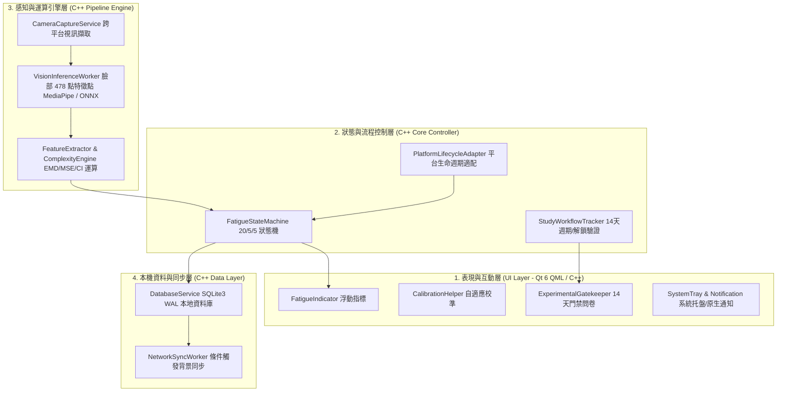

# Eye Fatigue Detection (EFD) 系統架構設計規範 - C++ 跨平台原生架構

## 1. 系統簡介 (System Overview)

本研究旨在開發一款基於 **C++ 單一核心語言** 的跨平台眼睛疲勞偵測與干預應用程式（EFD Native App）。應用程式具備完整的跨平台能力，能在 **Android、iOS、macOS、Windows** 四大主流作業系統上以原生高效能模式運行。

> **2026-10 更新：** 實際支援平台縮減為 **Windows (x64)** 與 **Android (AArch64)**。iOS / macOS 不允許背景使用相機，無法滿足背景守護需求，相關程式碼、建置流程與文件已移除；下文中提及 iOS / macOS 的段落屬原始規劃。

系統採用本機端邊緣運算（純 Client-Side Edge Computing），透過裝置攝影機捕捉影像，融合「常規幾何統計特徵（EAR, PERCLOS）」與「非線性時序複雜度特徵（EMD, MSE）」，動態評估疲勞狀態並給予個人化提醒，同時安全管控為期 14 天的科研實驗數據生命週期。

---

## 2. 核心技術棧 (Tech Stack)

- **核心開發語言:** **Modern C++ (C++20)**（涵蓋 90% 以上業務邏輯、演算法、多執行緒管線、資料庫與平台抽象）
- **跨平台 GUI 框架:** **Qt 6 (C++ / QML)**（支援 Desktop Windows/macOS 與 Mobile Android/iOS 原生渲染）
- **視覺推論引擎 (實作現況):** 兩個平台使用同一份 MediaPipe Face Landmarker 模型 (`models/face_landmarker.task`，478 點臉部特徵點)
  - _Android:_ **MediaPipe Tasks Vision 0.10.35** (Java API)，CPU 優先、GPU 備援；只把特徵點經 JNI 傳給 C++，影像不離開 Java 層
  - _Windows:_ **ONNX Runtime 1.31.0** (CPU)，執行由同一份模型轉出的 `face_detector.onnx` (BlazeFace 128×128) 與 `face_landmarks.onnx` (256×256)
  - 模型載入失敗時退回啟發式偵測器 (`FaceLandmarker`，膚色與眼部暗點規則)
- **非線性訊號處理:** 原生 C++ 演算法庫（結合 **Eigen** 與 SIMD 指令集加速 EMD 與 MSE 運算）
- **本機結構化儲存:** **原生 SQLite3 (C++ API)** + **WAL (Write-Ahead Logging)** 模式（零資料遺失）
- **網路同步傳輸:** **libcurl / Qt Network (C++)**（安全傳輸科研數據與問卷 Token）

---

## 3. 系統分層架構 (Layered Architecture)



### 3.1 表現與互動層 (UI & Presentation Layer)

- **FatigueIndicator (疲勞指示器):** 桌面端提供置頂輕量半透明懸浮視窗 / 行動端提供動態狀態列與卡片，具備「放鬆（綠）」、「注意（黃）」、「警報升級（紅）」三段視覺反饋。
- **CalibrationHelper (動態校準引導):** 首次啟動引導用戶進行眼睛基準線校準，並持續在背景執行**動態滑動窗口基準自適應**，消除光線與鏡頭角度造成的特徵漂移。
- **ExperimentalGatekeeper (實驗門禁):** 第 14 天到期自動鎖定主功能介面，強制進入問卷填答流程。
- **SystemTray & Notification (原生通知適配):**
  - _Windows / macOS:_ 系統托盤圖示常駐、Windows Toast / macOS UserNotification 提示。
  - _Android / iOS:_ 原生本地推播通知 (Local Push Notifications)。

### 3.2 狀態機與流程控制層 (Business Logic & State Layer)

- **FatigueStateMachine (20/5/5 狀態機):** 嚴格調度偵測頻率，管理 20 分鐘冷卻期、5 分鐘輕量快篩與 5 分鐘離座清零邏輯。
- **StudyWorkflowTracker (實驗跟蹤器):** 追蹤 14 天實驗進程、維護實驗加密金鑰、管理問卷上傳與事務型解鎖驗證。
- **PlatformLifecycleAdapter (平台適配層):** 統一處理 Windows/macOS 睡眠喚醒、Android 前台服務 (Foreground Service) 與 iOS 生命週期切換（進入背景暫停、前景熱恢復）。

### 3.3 運算與感知引擎層 (Computation Engine Layer)

- **CameraCaptureService:** 封裝 Qt Multimedia (`QCamera`) / 原生平台 API，提供穩定 30 FPS 的 YUV/RGB 影像串流。
- **VisionInferenceWorker:** 透過 `ILandmarkDetector` 介面取得臉部特徵點：Android 由 MediaPipe 偵測後經 `submitExternalDetection` 遞交，Windows 由 `OnnxFaceLandmarker` 在推論執行緒執行；兩者都輸出 478 點實際量測的 3D 座標 (`landmarksMeasured = true`)。
- **ComplexityEngine (C++ 核心):**
  - 幾何特徵：計算雙眼 $\text{EAR}$ (Eye Aspect Ratio)、$\text{PERCLOS}$、眨眼頻率。
  - 非線性特徵：利用 C++ 高效實作 **EMD (經驗模態分解)** 分離瞬態特徵，並透過 **MSE (多尺度熵)** 計算信號複雜度指數（$\text{CI}$）。

### 3.4 本機儲存與同步層 (Data & Persistence Layer)

- **DatabaseService (原生 SQLite3 C++):**
  - 啟用 `PRAGMA journal_mode=WAL;` 與 `PRAGMA synchronous=NORMAL;`，保證資料即時落盤且不阻塞查詢。
  - 保存每分鐘特徵統計、警報歷史、校準參數與問卷記錄。
- **NetworkSyncWorker (C++ 背景同步):** 當裝置滿足「連線 Wi-Fi + 夜間/充電中」條件時，將結構化資料安全上傳至研究中心伺服器。

---

## 4. 原生多執行緒非阻塞管線 (Threading & Pipeline Model)

為杜絕介面掉幀（Jank），系統採用全非同步管線模型，各執行緒職責明確：

```
[Camera Hardware]
       │
       ▼ (Raw Frames)
[Thread 1: Video Capture Thread] ──── (Lock-free Ring Buffer)
       │
       ▼ (Frame Buffer)
[Thread 2: Vision & Inference Worker] ─── (478 Landmarks)
       │
       ▼ (Time-Series Features)
[Thread 3: Signal Processing & State Worker] (EMD / MSE / 20-5-5 FSM)
       │                                  │
       ▼ (State Update Event)             ▼ (Batch Metrics)
[Thread 0: Main UI Thread]        [Thread 4: Database IO Worker]
  (60/120 FPS QML Render)            (SQLite WAL Commit)
```

1.  **Main UI Thread (執行緒 0):** 專注於 Qt Quick 畫面渲染與用戶點擊互動，零重度計算，確保 60/120 FPS 流暢度。
2.  **Video Capture Thread (執行緒 1):** 負責攝影機取幀，透過無鎖環形緩衝區（Lock-free Ring Buffer）傳遞最新影格，自動丟棄過期幀。
3.  **Vision & Inference Thread (執行緒 2):** 呼叫硬體加速（Metal/DirectML/NNAPI）執行神經網路推論。
4.  **Signal & State Worker (執行緒 3):** 累積時序訊號，執行 EMD/MSE 計算，驅動疲勞狀態機轉移。
5.  **Database Worker (執行緒 4):** 佇列化批次寫入 SQLite，完全消除磁碟 I/O 對運算與畫面的影響。

---

## 5. 核心演算法與動態防打擾邏輯

### 5.1 動態滑動窗口基準自適應 (Sliding-window Adaptive Baseline)

針對不同鏡頭角度與環境光線差異，系統採用動態自適應 EAR 閾值：
$$\text{EAR}_{\text{threshold}}(t) = \alpha \cdot \text{EAR}_{\text{baseline}} + (1 - \alpha) \cdot \mu_{\text{window}}(t) - k \cdot \sigma_{\text{window}}(t)$$

- $\text{EAR}_{\text{baseline}}$: 初始校準基礎值。
- $\mu_{\text{window}}, \sigma_{\text{window}}$: 過去 10 分鐘清醒狀態之滑動窗口平均值與標準差。
- $\alpha \in [0.6, 0.8]$: 動態衰減權重，自動抵消光線漸變引起的特徵漂移。
- **生理安全硬下限保護 (Physiological Clamp):** 閉眼狀態下停止侵蝕基準，且自適應動態閾值設有剛性安全下限 $\text{EAR}_{\text{threshold}} \ge 0.180$（上限 $\le 0.350$），杜絕閾值因長時間微閉眼單調下沉至 0.103 等不可達水平，確保閉眼與眨眼事件隨時可被靈敏捕捉。

上式為啟發式偵測器的門檻。模型偵測器 (MediaPipe / ONNX) 量到的是真實 EAR，改用 `RollingOpenBaseline`：

- **睜眼基準:** 最近 120 秒 EAR 去掉最低 20% 後的中位數 (累積不足 10 秒時用校準值)；已達閉眼門檻的幀不納入，避免長時間閉眼把基準往下拉 (A71 實測曾從 0.093 掉到 0.054)。
- **PERCLOS 門檻 (P80):** 眼瞼閉合 80% 以上才算閉眼：$\text{EAR}_{\text{closed}} + 0.2 \times (\text{EAR}_{\text{open}} - \text{EAR}_{\text{closed}})$，$\text{EAR}_{\text{closed}} = 0.05$ (A71 實測閉眼 0.03~0.06)。
- **眨眼門檻 (P50):** 閉合 50% 即算眨眼的開始：$\text{EAR}_{\text{closed}} + 0.5 \times (\text{EAR}_{\text{open}} - \text{EAR}_{\text{closed}})$。
- 基準跟隨最近 2 分鐘，低頭看手機時 (EAR 0.14~0.17) 不會被當成閉眼；舊門檻曾讓低頭 30 秒觸發假提醒。

### 5.2 20/5/5 防打擾與算力節能狀態機

本節為 20/5/5 的唯一規格來源，實作位於 `src/state/FatigueStateMachine.cpp`，並由 `tests/test_features.cpp` 第 5、13 項測試驗證。

- **判定分數 (Smoothed Score):** 每幀計算即時疲勞分數後，以時間常數 20 秒的指數加權移動平均 (EWMA) 得到平滑分數；疲勞等級與所有警報判定皆以平滑分數為準（$<45$ Relaxed、$\ge 45$ Attention、$\ge 65$ SevereWarning），避免揉眼、短暫誤判造成誤報。
- **觸發提醒 (Fatigue Alert):** 常態追蹤中，平滑分數 (20 秒時間常數) $\ge 65$ 且**持續 5 秒**才發送提醒 (原為 60 秒平滑、持續 10 秒，實測持續閉眼要 1.5~2 分鐘才提醒，2026-11-03 調整；模擬持續閉眼約 28 秒、疲倦慢眨眼約 1 分鐘觸發，低頭看手機不觸發)，並進入 **20 分鐘冷卻期**。$45 \sim 65$ 只更新畫面狀態，不彈窗、不消耗冷卻。
- **冷卻期 (20m Cooldown):** 冷卻期間完全不提醒，但疲勞等級仍反映真實狀態。冷卻以真實時間倒數，使用者離座期間照常倒數。
- **快篩 (5m Fast Screening):** 冷卻期滿後進入快篩，以**每 5 分鐘在座時間**的平均即時分數判定一次：
  - 平均 $\ge 65$：再提醒一次並重新進入 20 分鐘冷卻；
  - 平均 $< 45$：回到常態追蹤；
  - 介於兩者之間：不提醒，繼續下一輪 5 分鐘快篩。
  - 窗口未滿 5 分鐘不提前判定。
- **離座自動歸零 (5m Auto-Reset):** 連續 5 分鐘未偵測到人臉，視為已休息：清除冷卻與快篩，平滑分數歸零，回到常態追蹤。App 關閉期間比照離座計時。
- **提示靈敏度 (Sensitivity):** 只調整「提醒門檻」與「需持續秒數」，冷卻 20 分鐘、快篩 5 分鐘、離座 5 分鐘清零等時間規則不變；設定保存在設定檔的 `sensitivityLevel` 欄位 (由第 20 項測試驗證)。Windows 以開關切換標準與高，Android 可在三段間切換。

  | 等級 | 提醒門檻 (平滑分數) | 需持續 |
  | :--- | :--- | :--- |
  | 低 | $\ge 70$ | 10 秒 |
  | 標準 (預設) | $\ge 65$ | 5 秒 |
  | 高 | $\ge 58$ | 3 秒 |

  快篩期的「再次提醒」同樣使用該等級的門檻；「回到常態追蹤」的 $< 45$ 不隨等級改變。
- **持久化 (Persistence):** 冷卻狀態每 10 秒與暫停/停止時寫入 `efd_fsm_state.txt`；重啟時扣除關閉期間的時間繼續倒數，關閉滿 5 分鐘則比照離座清零。
- **高精度實時時鐘驅動 (Real-time Clock Delta):** 狀態機以 std::chrono::steady_clock 取得每幀真實時間增量（$\Delta t$，上限 2 秒），不以固定 1/FPS 估算。

### 5.3 眼睛特徵萃取與滑動窗口計算規範 (Eye Feature Extraction Pipeline)

- **目前的臉部與眼部偵測方式 (實作現況):** Android 以 MediaPipe Face Landmarker、Windows 以 ONNX Runtime 執行同一份模型，量測 478 點特徵點 (EAR 取 MediaPipe 索引 左眼 33/160/158/133/153/144、右眼 362/385/387/263/373/380)。Windows ONNX 流程：BlazeFace 找臉 (896 個錨點) → 依兩眼連線轉正、放大 1.5 倍裁切 256×256 → 特徵點模型 → 座標換回原圖；鎖定後沿用上一幀位置追蹤。在座判定：模型找不到臉滿 1 秒才判定離座。手機實測要點：MediaPipe 不受畫面方向影響 (0°/90°/270° 都偵測得到)；手機拿得很低、由下往上拍時，閉眼與低頭在畫面上難以區分，受試者應把手機拿到與眼睛同高。
- **啟發式備援偵測器 (模型無法載入時):** `FaceLandmarker` 以膚色網格密度聚類定位臉部；膚色衣服或脖子與臉連成一塊時，逐列量測膚色寬度 (每列取最長連續段、上下 13 列中位數)，在「臉 → 脖子變窄 → 衣服變寬」處切開，只保留頭部 (第 23 項測試)；依面積最多檢查 3 塊膚色區域，臉被下巴陰影與較大的衣服分開時仍可偵測 (第 24 項)；膚色需 R−G ≥ 15，排除暖光下的米白牆面 (第 25 項)。**在座 ≠ 看得到眼睛**：PERCLOS 統計的正是閉眼時間，因此第一次鎖定臉部需要眼睛特徵 (排除膚色物體)，鎖定後只要同一位置 (距離 < 0.5 臉寬、大小 0.6~1.6 倍) 仍有符合臉形的膚色區域，閉眼、眨眼、低頭仍判定在座並計入 PERCLOS；該區域消失滿 1 秒才判定離座 (第 26 項)。眼部需同時具備明顯暗點 (瞳孔/睫毛，亮度 < 膚色 60% 的像素 ≥ 4%)、反差 ≥ 20 與垂直梯度 ≥ 3 才判定為真人；連續 1 秒未偵測到才判定離座。此為啟發式方法，光線過暗或深色鏡框可能影響準確度。
- **AOI 二值化與瞳孔/睫毛黑色像素比例 (Black Pixels Ratio):** 在雙眼感興趣區域 (AOI) 計算黑色像素佔比 $P_{\text{black}}$；睜眼基準取最近 60 秒暗部比例的第 90 百分位 (可隨光線上下調整)，透過動態範圍映射獲得連續開闔度。
- **校準 (Calibration):** 兩段式收集，只採用校準期間偵測到人臉的幀；有效幀不足 60% 或少於 20 幀即校準失敗並保留原基準。閉眼閾值限制在清醒基準的 65%~85%，之後的自動調整只能在校準閾值 ±15% 內浮動。校準結果保存於設定檔，重啟後自動還原。
- **時間窗口 PERCLOS (Time-based PERCLOS):** 以**時間**定義的 60 秒窗口 (非固定幀數)，PERCLOS = 窗口內閉眼 (P80) 時間 / 窗口總時間；每個樣本代表的時間依實測幀率計算，手機 10 FPS 與桌機 30 FPS 結果一致。
- **生理有效眨眼檢驗 (Physiological Blink Validation):** 眨眼 (P50) 判定要求閉眼持續 60 ~ 800 ms (以時間判斷，與幀率無關)；超過 800 ms 的閉眼不算眨眼，另計為**長閉眼次數/分** (含尚未睜開的這一次)；窗口累積 30 秒前不輸出眨眼率、眨眼平均時長與長閉眼次數 (不計分)；每分鐘眨眼率設置生理硬上限（[0.0, 60.0] 次/分）。手機每秒分析 10 張，短於 0.1 秒的眨眼可能漏掉，眨眼率可能偏低。
- **複雜度 (EMD + MSE):** 每秒一次，將 60 秒 EAR 序列依時間重新取樣為 10 Hz，以 EMD 去除最高頻 IMF 後計算 MSE (尺度 1~5, m = 2)。容許誤差 $r$ **固定為個人睜眼 EAR 範圍的 15%** ($0.15 \times (\text{EAR}_{\text{open}} - 0.05)$)，不隨窗口標準差縮放：若 $r$ 隨標準差縮放，長時間閉眼時 EAR 近乎平線，$r$ 縮到雜訊大小，雜訊反而被算成高複雜度 (實測半閉眼時 CI 升到 7~8.7)。A71 實測清醒看螢幕 CI 約 1.3~2.2、長時間閉眼 0.35~0.65；資料不足 30 秒時使用清醒先驗值 CI = 2.0 (不計分)。半閉眼並維持注意時 CI 不一定下降 (眼瞼仍有細微動作)，此時主要由 PERCLOS 與眨眼判斷。

### 5.4 疲勞分數 (Fatigue Score)

實作位於 `FatigueStateMachine::computeFatigueScore`，由第 36 項測試驗證：

各分項換算成 0~100 分 (下表，除以 100 為 0~1) 後累加：

$$\text{Score} = 100\big[1 - (1 - 0.9\,S_{\text{PERCLOS}})(1 - 0.4\,S_{\text{slow}})(1 - 0.25\,S_{\text{rate}})(1 - 0.35\,S_{\text{CI}})\big]$$

| 分項 | 0 分 | 計分方式 |
| :--- | :--- | :--- |
| $S_{\text{PERCLOS}}$ | PERCLOS 0% | 分段線性：3% → 15 分、8% → 50 分、15% → 85 分、25% 以上 100 分 |
| $S_{\text{slow}}$ | 眨眼 ≤ 250 ms、無長閉眼 | 取兩者較高：眨眼平均時長 > 250 ms (450 ms 約 85 分)；長閉眼每分鐘 3 次約 85 分 |
| $S_{\text{rate}}$ | 眨眼率 10~22 次/分 | 眨眼率 < 10 或 > 22 次/分 (2 次/分以下或 36 次/分以上達 85 分) |
| $S_{\text{CI}}$ | CI ≥ 1.0 | CI 1.0 → 0.3 線性升到 80 分 |

- **為什麼用累加 (2026-11-04 起):** 原本的加權平均 $\max(0.55 S_{\text{PERCLOS}} + 0.25 S_{\text{blink}} + 0.20 S_{\text{CI}},\ 0.9 S_{\text{PERCLOS}})$ 要每一項都很嚴重才到 65，A71 實測除了持續閉眼 30 秒以上幾乎不會提醒。累加時任一項單獨很強仍可觸發 (PERCLOS 約 12.5% 以上即可單獨達到 65)，數項中等異常同時出現也會疊加到門檻 (例如 PERCLOS 10% + 眨眼 350 ms + 長閉眼 3 次/分)。
- **權重:** $S_{\text{slow}}$、$S_{\text{rate}}$ 權重較低：手機每秒只分析 10 張，A71 正常使用時眨眼率中位數約 5 次/分，長閉眼也常出現 (低頭時眼瞼位置較低)。以 A71 11/3~11/4 的 179 分鐘正常使用資料重算：$S_{\text{slow}}$ 權重 0.4 時只有 1 分鐘超過 65 (11/4 00:25 深夜，PERCLOS 7%、長閉眼 6 次/分)，0.6 時增加到 3 分鐘。
- **實測 (A71，舊公式):** 清醒時段 25 分以下；刻意閉眼 / 半閉眼約 2 分鐘後觸發提醒，提醒當分鐘 CI 0.69、長閉眼 3 次/分。

### 5.5 交叉設計、每分鐘摘要與提醒自評

- **A/B 分組:** 歡迎頁之後由研究人員選組，選定後鎖定 (設定檔 `studyGroup`)。A 組第 1~7 天只收數據、第 8~14 天提醒；B 組相反。不提醒的那一週照常判定、冷卻並關閉相機，只是不顯示提醒，記錄為 `suppressed`。
- **提醒時的眼睛疲勞自評:** 每次顯示提醒時詢問一題「眼睛疲勞程度 0 (完全不累) ~ 10 (非常疲勞)」，點一下即完成，可略過，30 秒未作答記為略過；App 在背景時改發通知，通知上直接顯示 0~10 按鈕 (點一下即記錄、劃掉通知記為略過)，沒按按鈕則在 30 分鐘內開啟 App 時補問。三星「簡短」彈出式通知不顯示按鈕，需下拉通知欄作答。因為只在判定疲勞時詢問，無法估計漏報率。
- **每分鐘摘要:** `StudyDataLog` 每分鐘寫一列 (`efd_minute_summary.csv`)：在座秒數、相機開啟秒數、EAR 平均與第 10 百分位、PERCLOS、眨眼次數與平均時長、CI、平滑分數、冷卻狀態、提醒 (`none` / `shown` / `suppressed`)、偵測器、平台、App 版本、長閉眼次數；自評寫入 `efd_eye_fatigue.csv`。每日上傳時附上最近 3 天的資料 (Apps Script 依受試者與時間去重)。
- **量表範圍與日誌一致性:** 疲勞評分統一採用標準 0.0 ~ 100.0 分制（注意閾值 45.0，警報閾值 65.0）；人臉在場診斷日誌使用動態符號（`>=` 或 `<` 及追蹤寬限標籤），杜絕日誌條件與數值矛盾。

---

## 6. 四大平台特性與常駐支援 (Cross-Platform Implementation)

```
┌──────────────────────────────────────────────────────────────────┐
│                   EFD Core C++20 Shared Library                  │
│       (Algorithms, Vision, State Machine, SQLite, Network)       │
└────────────────┬────────────────┬────────────────┬───────────────┘
                 │                │                │
        ┌────────┴───────┐ ┌──────┴────────┐ ┌─────┴──────────┐
        ▼                ▼ ▼               ▼ ▼                ▼
┌──────────────┐ ┌──────────────┐ ┌────────────────┐ ┌────────────────┐
│   Windows    │ │    macOS     │ │    Android     │ │      iOS       │
│ Qt Desktop   │ │ Qt Desktop   │ │ Qt Android/NDK │ │ Qt iOS/Obj-C++ │
│ WinToast     │ │ NSUserNotif  │ │ Foreground Svc │ │ Local Push     │
│ System Tray  │ │ Status Item  │ │ Camera2 / NDK  │ │ Hot-Resume Mgr │
└──────────────┘ └──────────────┘ └────────────────┘ └────────────────┘
```

> 註：上圖為原始規劃。目前各平台介面皆為原生實作 (Windows Win32 + GDI+、macOS Cocoa、Android View、iOS UIKit)，未使用 Qt。iOS / macOS 已於 2026-10 移除。

| 平台        | 常駐機制 (Background Mode)                                            | 視訊擷取 (Camera Input)                   | 資料目錄 / 每日同步                               |
| :---------- | :-------------------------------------------------------------------- | :---------------------------------------- | :------------------------------------------------ |
| **Windows** | 最小化至系統托盤 (System Tray)，背景持續偵測                          | Media Foundation：選最接近 640x480 的原生格式，請系統轉 RGB32/RGB24，失敗時自行解碼 NV12 / YUY2 / UYVY；依實際解析度、stride (含行尾補齊、由下而上) 讀取，720p 以上整數倍縮到寬約 640 (第 27 項測試) | 執行檔工作目錄；C++ 引擎 21:00 同步 + 補傳 (PowerShell) |
| **Android** | **前景服務 (camera 類型)** 擁有偵測引擎，App 介面被劃掉後仍持續偵測與提醒；首次進入監控頁引導加入電池最佳化白名單，接著依廠牌 (小米、OPPO、vivo、華為、三星) 說明背景執行設定並可直接開啟 App 設定 (OPPO Reno13 Pro / Android 16 需另選「完全允許背景行為」)。Android 14+ 不允許開機自動開相機，改發「點此開始今日偵測」通知 | CameraX (ImageAnalysis，RGBA) → MediaPipe → 特徵點經 JNI 傳給 C++；前鏡頭輸出取手機支援範圍中「最低 ≥ 10 FPS、上限最小」的一組 (A71 為 15/15)，分析 10 FPS，連續 10 秒無臉降為 2 FPS | `filesDir`；Java `EfdSyncManager` 21:00 鬧鐘 + 補傳 + 失敗 10 分鐘重試 (C++ 端同步關閉) |

- **每日同步共同規則:** 上傳成功才標記已同步；失敗 10 分鐘後重試；21:00 前若發現昨天 (含) 以前的資料尚未上傳，立即補傳。伺服器回傳 HTML (要求登入或 Apps Script 出錯) 時判定為失敗。
- **相機省電:** 20 分鐘冷卻期間關閉相機；快篩 5 分鐘只在最後 1 分鐘開相機取樣；螢幕關閉時暫停 (Android)；連續 10 秒沒有臉時降低偵測頻率 (兩平台)。A71 實測無臉時 CPU 由約 98% 降到 39% (App 在背景)，螢幕關閉時約 0.2%。
- **離座探測 (Android):** 降頻後相機仍以 15 FPS 輸出，A71 的相機系統服務約佔 86% 核心 (前鏡頭最低固定幀率即 15)。因此相機開著卻連續 60 秒沒有臉時，改為關 15 秒、開 4 秒輪流探測；關閉時段視為不在座 (照常累計離座時間，滿 5 分鐘算休息)，每分鐘摘要的 `camera_on_sec` 不計入；探測到臉立即恢復常態。Windows 不開啟 (視訊鏡頭指示燈會一亮一滅)。
- **相機解析度 (Android):** 影像分析以 `ResolutionSelector` 指定 640x480 (4:3)。舊寫法 `setTargetResolution` 以直式座標解讀，A71 因此選到 1088x1088，每幀像素多 3.9 倍。
- **耗電實測 (A71，2026-11-03):** 螢幕開著播 YouTube 並偵測時整支手機每小時約 13%；Samsung 耗電統計估 EFD 在相機開著時約 250–290 mAh/h (電池 4370 mAh 的 6–7%/h)。有臉時 EFD 約佔 1.1 顆核心、相機系統服務 0.74 顆；無臉降頻後 EFD 0.34 顆、相機系統服務仍 0.86 顆 (上述兩項改進前)。
- **模擬相機:** 實體鏡頭無畫面時會切換為模擬相機以維持管線運作，但模擬影格不寫入研究資料庫。
- **Android 診斷與錯誤回報:** 監控中心未偵測到臉時顯示原因 (卡在哪一關) 與相機畫面尺寸、fps。開發期間的「匯出診斷畫面」(存相簿)、「立即上傳數據」與監控中心的「回報問題」已在正式版前移除；「測試背景通知」10 秒後送出「【測試通知】」，與真實疲勞提醒文字區隔；服務被廠商系統關閉時，看門狗 (每 15 分鐘，07:00~23:00) 發出「EFD 疲勞偵測已停止」。Windows 以 `efd_diag_replay --capture` 擷取相機畫面檢查格式。電腦端以 `tests/convert_to_ppm.ps1` 把傳回的 JPG/PNG 轉成 PPM，再以 `efd_diag_replay <資料夾>` 重播同一套判斷；`--engine` 同時比較啟發式與 ONNX 模型；`--csv` 把手機 debug 版 logcat 的 `EFD_Frame` 記錄 (或「秒,EAR」CSV) 依 App 相同流程重算疲勞分數與提醒時間。`debug_frames/` 不進版本庫。
- **上傳 JSON 格式 (四平台共用):** 由 `NetworkSyncWorker::buildPayloadJson()` 產生，Android 經 JNI 呼叫同一函式 (不附逐筆 `records`)。`metrics` 的 EAR、PERCLOS、CI 與 `fatigue_score` 為資料庫紀錄的實際平均；`blink_rate` 為有效眨眼率的平均 (窗口未滿 30 秒的 0 值不計入)；無紀錄時上述欄位為 `null`、`record_count` 為 0。`status` 為研究流程狀態 (`Active` / `Locked` / `Completed`)；`checksum` 由紀錄內容計算；`token` 為填寫後測問卷後產生的解鎖憑證，未取得時為空字串。資料庫每列新增第 8 欄 `BlinkRatePerMin`，讀取時相容舊版 7 欄資料。另附 `study_group` (受試者研究組別 `A` / `B`，未選組時為空字串，供試算表每日摘要加一欄)、`minute_summaries` (每分鐘摘要，每列另有 `group`) 與 `kss_responses` (提醒自評) 兩個陣列；上傳內容只有數值，不含任何影像。
- **開機自動啟動:** Windows 寫入 `HKCU\...\Run` (舊版另建的「啟動」資料夾捷徑會被清除，避免開機啟動兩次)；Android 14+ 以開機通知代替。

---

## 7. 14 天實驗流程與事務型安全門禁 (14-Day Study Lifecycle)

1.  **Day 1 ~ Day 13 (正常實驗採樣期):**
    - 系統背景執行 20/5/5 偵測與提醒。
    - SQLite 持續記錄特徵時序資料（匿名 UUID 標記）。
2.  **Day 14 (期滿鎖定):**
    - `StudyWorkflowTracker` 偵測到實驗期滿，觸發 `ExperimentalGatekeeper`。
    - 鎖定所有疲勞偵測 UI，全螢幕呈現後測研究問卷。
3.  **事務型問卷上傳與安全解鎖 (Transactional Unlock):**
    - 用戶提交問卷 $\to$ `NetworkSyncWorker` 將「14天時序指標總結 + 問卷回答」打包上傳伺服器。
    - 伺服器驗證資料完整無缺後，回傳經數位簽章的 **Unlock Token**。
    - App 驗證 Token 成功後，解鎖本機 SQLite，並向受試者顯示「實驗完成代碼」與「軟體解除安裝安全指南」。

---

## 8. 模組代碼架構規劃 (Recommended Code Structure)

> 註：本節為原始規劃，實際目錄見 README 第 6 節。

```
efd-core/
├── CMakeLists.txt                # 跨平台 CMake 建置腳本 (支援 Desktop / Android NDK / iOS)
├── src/
│   ├── main.cpp                  # 應用程式進入點與 Qt 實例化
│   ├── vision/                   # 視覺與特徵偵測
│   │   ├── CameraService.hpp/cpp # 跨平台相機串流封裝
│   │   └── FaceLandmarker.hpp/cpp# 人臉特徵推論 (實作：OnnxFaceLandmarker 與啟發式 FaceLandmarker)
│   ├── analysis/                 # 訊號與數學運算
│   │   ├── FeatureExtractor.hpp  # EAR / PERCLOS / 眨眼特徵
│   │   ├── EmdCalculator.hpp/cpp # C++ 經驗模態分解
│   │   └── MseCalculator.hpp/cpp # 多尺度熵與 CI 複雜度指數
│   ├── state/                    # 狀態機與業務邏輯
│   │   ├── FatigueStateMachine.hpp/cpp # 20/5/5 狀態機
│   │   └── AdaptiveBaseline.hpp  # 滑動窗口動態基準
│   ├── storage/                  # 資料庫與持久化
│   │   └── DatabaseManager.hpp/cpp # SQLite3 WAL 原生封裝
│   ├── study/                    # 科研實驗控管
│   │   └── StudyLifecycle.hpp/cpp# 14 天計時與安全門禁
│   ├── platform/                 # 跨平台原生適配
│   │   ├── windows/              # Windows 托盤與通知
│   │   ├── macos/                # macOS 狀態列與通知
│   │   ├── android/              # Android Foreground Service / JNI
│   │   └── ios/                  # iOS 生命週期管理與 Push
│   └── ui/                       # Qt Quick / QML 介面
│       ├── qml/
│       │   ├── Main.qml
│       │   ├── FatigueIndicator.qml
│       │   ├── CalibrationDialog.qml
│       │   └── QuestionnaireGate.qml
│       └── UIController.hpp/cpp  # QML 與 C++ Core 資料綁定
```

---

## 9. 建議實作路線圖 (Implementation Roadmap)

- **階段一：C++ 原生運算核心與管線 (Core Pipeline MVP)**
  - 搭建 CMake 跨平台建置系統（支援 MSVC/Clang/Android NDK/Xcode）。
  - 整合 ONNX Runtime C++，完成相機取幀到 478 點特徵定位。
  - 實作 EAR、EMD、MSE 演算法，建立獨立單元測試 (Unit Tests)。
- **階段二：狀態機與多執行緒整合 (Multithreaded Engine)**
  - 建立 5 執行緒非同步管線（Ring Buffer）。
  - 實作 `FatigueStateMachine` (20/5/5) 與 `AdaptiveBaseline` 動態自適應。
- **階段三：資料持久化與科研流程 (Data & Study Control)**
  - 實作 SQLite3 WAL 本地資料庫服務，保證零資料遺失。
  - 實作 14 天實驗追蹤與 `ExperimentalGatekeeper` 事務解鎖。
- **階段四：Qt 6 UI 渲染與四大平台原生打磨 (Polishing & Deployment)**
  - 開發 QML 懸浮指標與校準 UI。
  - 完成 Windows 托盤、macOS 狀態列、Android 前台服務及 iOS 生命週期適配。
